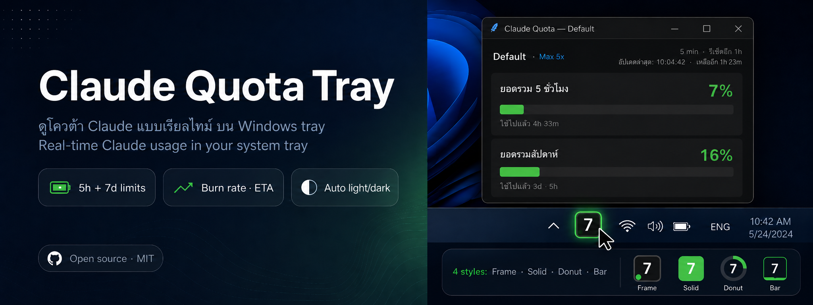
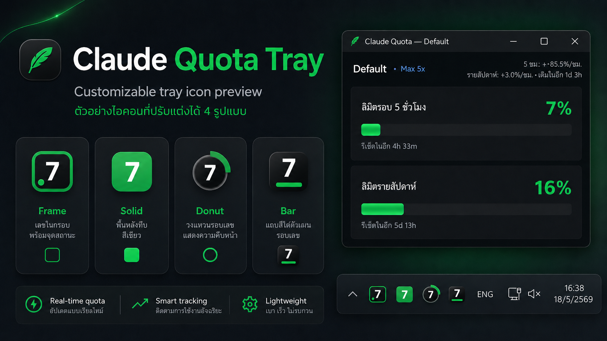
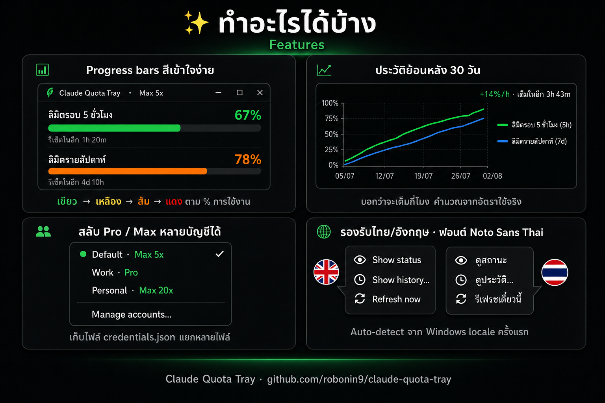
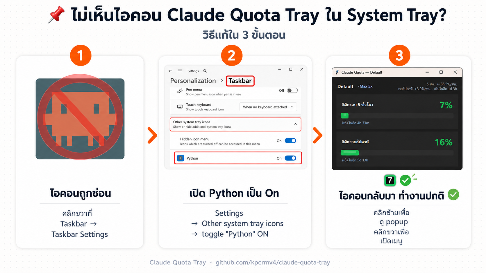

# Claude Quota Tray

[](https://github.com/robonin9/claude-quota-tray/actions/workflows/ci.yml)

<p align="center">
  
</p>

ไอคอน system tray สำหรับ **Windows** ที่แสดงปริมาณการใช้งาน Claude (5-hour limit และ Weekly limit) ที่เหลืออยู่ — แค่เหลือบดูมุมจอก็รู้

📘 **คู่มือภาษาไทยฉบับเต็ม (วิธีใช้ + คำแนะนำการตั้งค่า):** [README.th.md](README.th.md)

<p align="center">
  
</p>

> หลักการทำงานเดียวกับโปรเจกต์ [Clawdmeter](https://github.com/HermannBjorgvin/Clawdmeter) แต่แสดงผลผ่าน system tray แทน ESP32 hardware

**Fork นี้** ดัดแปลงจาก [kpcrmv4/claude-quota-tray](https://github.com/kpcrmv4/claude-quota-tray) — รายละเอียดการเปลี่ยนแปลงทั้งหมดอยู่ใน **[CHANGELOG.md](CHANGELOG.md)** (OAuth หลายแหล่ง, Claude Desktop, ความเสถียร tray บน Windows ฯลฯ)

## รองรับ OS

**Windows 10 / 11 (แนะนำ)** — ฟีเจอร์ครบ: toast (`windows-toasts`), desktop widget, Setup/Update `.bat`, startup shortcut

**macOS 13+ (เบต้า)** — tray + poll + history จาก source (`scripts/setup_mac.sh`) หรือ `.app` unsigned จาก [Releases](../../releases) (อาจต้องคลิกขวา → Open ครั้งแรก) — ดู [docs/SIGNING.md](docs/SIGNING.md)
> ตั้งแต่ 0.6.0 บน macOS ให้ Tk เป็นเจ้าของ main thread และไอคอนบน menu bar ใช้ event loop เดียวกับ Tk (ไม่มีไอคอนใน Dock) หน้าต่างต่างๆ (popup / history / dialog) จึงเปิดได้แล้ว — CI ทดสอบบน macOS ทุกครั้งที่ push (unit tests + `--self-test`) แต่ยังเป็น **เบต้า** จนกว่าจะมีคนใช้บน Mac จริง และยังไม่มี desktop widget
>
> **มี Mac? ช่วยทดสอบได้:** รัน `python3 src/main.py --self-test` แล้วแนบผลที่พิมพ์ออกมา (และ `error.log` ถ้ามี) มาใน [issue](https://github.com/robonin9/claude-quota-tray/issues) — คำสั่งนี้ใช้ข้อมูลจำลองในโฟลเดอร์ชั่วคราว ไม่แตะ token หรือ settings จริง

การ sign `.exe` บน Windows (optional): [docs/SIGNING.md](docs/SIGNING.md) — ต้องมี OV/EV `.pfx` ของ maintainer

## คุณสมบัติ

- 🔋 แสดง % การใช้งานบน tray icon (เปลี่ยนสีตามระดับ — เขียว/เหลือง/ส้ม/แดง พร้อมตัวอักษรปรับสีอัตโนมัติให้อ่านง่ายบนทุกพื้นหลัง)
- 🖱️ คลิกซ้าย → popup เล็กพร้อมหลอด progress bar 2 หลอด (5-hour + Weekly) + burn rate / ETA
- 🖱️ คลิกขวา → เมนูพร้อม Unicode progress bar `🟡 5h ███████░░░ 67%` อ่านได้จากเมนูเลย
- 📈 หน้าต่าง history — กราฟ Session / Weekly แยกแผง, เลือกช่วง **24 ชม. / 7 วัน / 30 วัน (รายเดือน)**, hover ดูค่าแต่ละจุด, ส่งออก CSV
- 📊 Desktop widget (Windows) — แถบ quota เล็กลอยบนจอ always-on-top
- 🔥 Burn rate / ETA — บอกว่าใช้กี่ %/ชม. และจะเต็มในกี่ชั่วโมง
- 👥 Multi-account — สลับเช็คหลาย Claude Code credentials ได้
- 🔔 Custom thresholds + เสียงเตือน — กำหนดเองได้ เช่น 60/80/95%
- ⏰ Schedule — pause polling นอกเวลาทำงาน (เช่น เฉพาะ จ–ศ 9:00–18:00)
- 🌗 Auto theme — ตามธีม Windows light/dark
- 💾 History storage — เก็บ snapshot ใน SQLite (default 7 วัน) สำหรับวาดกราฟและคำนวณ burn rate
- 💰 ใช้ OAuth token ของ Claude Code ที่มีอยู่แล้ว ไม่ต้องเปิด API account แยก
- 🪶 ค่าใช้จ่ายต่อ poll ≈ 1 token Haiku (สำหรับผู้ใช้ subscription รวมในแพ็คเกจอยู่แล้ว)
- 🔄 กู้ token หมดอายุอัตโนมัติ — Claude Code หมุน OAuth token เป็นระยะ พอแอปเจอ `401` จะอ่าน token ใหม่จากดิสก์แล้วลองใหม่เองทันที ไม่ต้องปิด-เปิดแอป
- 🔁 เมนู **Restart** (คลิกขวา) — รีสตาร์ทแอปได้จากเมนูเลย (โหลดโค้ด + token สดใหม่)

<p align="center">
  
</p>

## ความต้องการของระบบ

- Python 3.9 ขึ้นไป (เฉพาะตอน build จาก source — Setup script ติดตั้ง Python ให้เองได้ถ้ายังไม่มี)
- Sign in อย่างน้อยหนึ่งทาง: **[Claude Desktop](https://claude.ai/download)** หรือ **[Claude Code](https://docs.claude.com/en/docs/claude-code)** (`claude auth login`) — แอปค้นหา OAuth token อัตโนมัติ (หรือตั้ง `CLAUDE_CODE_OAUTH_TOKEN` / path ใน Account)

## วิธีใช้ (สำหรับ end user)

มี 2 วิธี — เลือกวิธีไหนก็ได้

### 🟢 วิธีที่ 1: ใช้ Source + Setup script (แนะนำ — ไม่โดน antivirus ฟ้อง)

1. ดาวน์โหลด ZIP จาก [Releases](../../releases/latest) หรือ `Code → Download ZIP` แล้วแตกไฟล์
2. ดับเบิ้ลคลิก **`Setup claude quota tray.bat`** — script จะ:
   - เช็คว่ามี Python หรือยัง
   - **ถ้าไม่มี → ขอ permission แล้วดาวน์โหลด + ติดตั้ง Python 3.13.x ให้เอง** (per-user, ไม่ต้อง admin)
   - สร้าง virtual environment ในโฟลเดอร์โปรเจกต์
   - ติดตั้ง dependencies (httpx, pystray, Pillow, pycryptodome, windows-toasts)
   - สร้าง Shortcut ใน Windows Startup folder อัตโนมัติ (รันตอนเปิดเครื่อง)
   - ถามว่าจะรันเลยตอนนี้ไหม

หลังจากนั้น:
- รันด้วยตัวเอง: ดับเบิ้ลคลิก **`Run claude quota tray.bat`**
- อัพเดตเป็นเวอร์ชันใหม่: แทนที่ไฟล์ source แล้วดับเบิ้ลคลิก **`Update claude quota tray.bat`** (จะหยุดแอปเก่า → install deps ใหม่ → รันใหม่)
- เลิกใช้: ดับเบิ้ลคลิก **`Uninstall claude quota tray.bat`** → ลบ shortcut + venv + (ถามว่าจะลบ user data ด้วยไหม)

### 🟡 วิธีที่ 2: ใช้ .exe สำเร็จรูป

1. ดาวน์โหลด `ClaudeQuotaTray.exe` จากหน้า [Releases](../../releases/latest)
2. ดับเบิ้ลคลิกเพื่อรัน — ไอคอนบน **taskbar** มาจาก `.exe` โดยตรง (ไม่ใช่ไอคอน Python)
3. ถ้าจะให้รันอัตโนมัติ: กด `Win+R` → `shell:startup` → Enter → ลาก `.exe` มาวาง

โหมด source: รัน `build.bat` แล้วรัน **Setup** อีกครั้ง — shortcut ใน Startup จะชี้ `dist\ClaudeQuotaTray.exe` แทน `pythonw.exe` (ถ้าไม่ build ไว้ taskbar ยังเป็นไอคอน Python ได้)

> ⚠️ **Windows Defender อาจเตือน** เพราะ `.exe` build ด้วย PyInstaller มักโดน flag เป็น unknown publisher คลิก "More info" → "Run anyway"

## วิธีรันจาก source (สำหรับนักพัฒนา / ทดสอบ)

```bash
git clone https://github.com/robonin9/claude-quota-tray.git
cd claude-quota-tray

# (แนะนำ) สร้าง virtual environment
python -m venv .venv
.venv\Scripts\activate          # Windows
# source .venv/bin/activate     # macOS / Linux

pip install --require-hashes -r requirements.lock   # เวอร์ชัน + hash ล็อกไว้ทุกตัว
python src/main.py
```

ตรวจว่าเครื่องรันแอปได้ (ใช้ได้ทั้ง Windows และ Mac):

```bash
python -m unittest discover -s tests   # unit tests
python src/main.py --self-test         # เปิดทุกหน้าต่าง + ไอคอน tray ด้วยข้อมูลจำลอง แล้วปิดเอง
```

`--self-test` ใช้โฟลเดอร์ข้อมูลชั่วคราว (หรือโฟลเดอร์ที่ตั้งใน `CQT_DATA_DIR`) ไม่ยิง API และไม่อ่าน token — exit code `0` = ผ่าน, `1` = มีบางอย่างพัง, `2` = ค้างเกิน 30 วินาที ถ้าตั้ง `CQT_SELFTEST_SCREENSHOT=<โฟลเดอร์>` จะเก็บภาพหน้าจอไว้ด้วย CI (`.github/workflows/ci.yml`) รันทั้งสองคำสั่งนี้บน Windows และ macOS ทุกครั้งที่ push

## วิธี build เป็น .exe (Windows)

```bash
.venv\Scripts\activate
pip install --require-hashes -r requirements-dev.lock   # รวม PyInstaller
python scripts/generate_app_icon.py   # สร้าง assets/app.ico (ถ้ายังไม่มี)
build.bat
```

**แก้ dependency:** แก้ `requirements.txt` / `requirements-dev.txt` (ไฟล์ที่คนแก้) แล้วสร้างไฟล์ lock ใหม่ด้วย `pip install uv==<UV_VERSION ใน scripts/lock_requirements.py>` + `python scripts/lock_requirements.py` แล้ว commit ไฟล์ `*.lock` ไปด้วย — CI (`lock-fresh`) จะ fail ถ้าลืม สคริปต์คงเวอร์ชันเดิมใน lock ไว้ (แพ็กเกจออกเวอร์ชันใหม่ไม่ทำให้ CI แดง) ถ้าจะอัปเดตทุกตัวเป็นเวอร์ชันล่าสุดให้ใช้ `python scripts/lock_requirements.py --upgrade`

ไฟล์ผลลัพธ์จะอยู่ที่ `dist/ClaudeQuotaTray.exe` (~30 MB) พร้อมไอคอนจาก `assets/app.ico`

วาง `.exe` ไว้โฟลเดอร์เดียวกับ `Setup` / `Update` / `Uninstall` `.bat` ได้ (ถ้ามี) เพื่อใช้เมนูติดตั้งจาก tray

## อัปเดตจาก GitHub (ในแอป)

คลิกขวา tray → **Install / update**:

| รายการ | ทำอะไร |
|--------|--------|
| **Check for updates** | เทียบเวอร์ชันกับ GitHub Releases — แจ้งว่ามีอัปเดตเฉพาะเมื่อ release ใหม่กว่า **และ** ตรวจลายเซ็นผ่านแล้ว |
| **Install latest release…** | ดาวน์โหลด zip source (หรือ `.exe`) **ตรวจลายเซ็น + เวอร์ชัน + hash ก่อน** ถ้าผ่านจึงติดตั้งแล้วรีสตาร์ท — ถ้าไม่ผ่านจะไม่แตะไฟล์ใดๆ |
| **Update source (GitHub repo)…** | ตั้ง repo เช่น `robonin9/claude-quota-tray` หรือ URL เต็ม |
| **Run Setup / Update / Uninstall** | เปิด `.bat` ในโฟลเดอร์ติดตั้ง (โหมด source + `.venv`) |

- ค่า repo เก็บใน `settings.json` คีย์ `update_github_repo` (ว่าง = ใช้ `config.DEFAULT_UPDATE_REPO`)
- Release บน GitHub **ต้องมี** asset (source `.zip` หรือ `ClaudeQuotaTray.exe`) **พร้อม `SHA256SUMS` และ `SHA256SUMS.sig`** ซึ่ง `release.yml` สร้างและเซ็นให้ตอน push tag `vX.Y.Z` — zip ที่ GitHub สร้างอัตโนมัติ (zipball) ใช้ไม่ได้แล้ว เพราะไม่มีลายเซ็น
- แอป **ไม่ลดเวอร์ชันและไม่ติดตั้ง pre-release**: เวอร์ชันที่เซ็นไว้ใน `SHA256SUMS` ต้องตรงกับ tag และต้องใหม่กว่าเวอร์ชันที่ติดตั้งอยู่
- **Fork / Update source ที่ชี้ไป repo อื่น** ต้องใส่ public key ของตัวเองใน `src/update_keys.py` (ดู [docs/SIGNING.md](docs/SIGNING.md)) ไม่อย่างนั้นการตรวจลายเซ็นจะไม่ผ่าน
- ทดสอบจากเทอร์มินัล: `python src/update_runner.py --check`

**ถ้ารันจาก `.exe`:** หลังกดยืนยัน แอปจะดาวน์โหลด `ClaudeQuotaTray.exe.new` มาตรวจ แสดง toast "Update will apply after you quit the app." แล้วปิดตัวเอง จากนั้น `Apply Claude Quota Tray update.bat` จะสลับไฟล์และเปิดแอปใหม่ ตั้งแต่ 0.6.0 สคริปต์จะลองสลับไฟล์ซ้ำนานสุด 30 วินาที (ไฟล์ `.exe` อาจยังถูกล็อกอยู่สักพักหลังแอปปิด) ถ้าสลับไม่สำเร็จจะเก็บ `.new` กับสคริปต์ไว้ให้รันซ้ำ และบันทึกลง `error.log`

> **อัปเดตจาก 0.5.0 หรือ 0.6.0:** ไฟล์ใหม่จะถูกสลับเข้าที่แล้ว แต่ตอนเปิดแอปใหม่อาจขึ้นกล่อง *"Failed to load Python DLL …\_MEI…\python312.dll"* ให้กด OK แล้วเปิด Claude Quota Tray เองอีกครั้ง (แก้แล้วใน 0.6.1 ใช้ได้กับการอัปเดตครั้งถัดไปเป็นต้นไป) ถ้าหลังจากนั้นยังมี `ClaudeQuotaTray.exe.new` ค้างข้าง `.exe` ให้ Quit แอปแล้วรัน `move /y ClaudeQuotaTray.exe.new ClaudeQuotaTray.exe` ในโฟลเดอร์นั้น — ไฟล์ `.new` ผ่านการตรวจลายเซ็นแล้ว

## การตั้งค่า

คลิกขวาที่ icon → **Settings**:

| Setting | ที่ตั้ง | หมายเหตุ |
|---------|--------|---------|
| **Alert thresholds** | Settings → Alert thresholds | preset (Quiet/Default/Sensitive) หรือ Custom… พิมพ์เอง |
| **Sound alerts** | Settings → Sound alerts | toggle (ใช้ winsound บน Windows) |
| **Schedule** | Settings → Schedule settings… | เลือกชั่วโมง start/end + วันในสัปดาห์ |
| **Icon theme** | Settings → Icon theme | Auto / Light / Dark |
| **Poll interval** | Settings → Poll interval | 30s / 1m / 2m / 5m |
| **Multiple accounts** | Account → Manage accounts… | Add/Rename/Remove credentials path |
| **Update source** | Install / update → Update source… | GitHub `owner/repo` สำหรับดึง release |

ค่าทั้งหมดเก็บที่ `~/.claude-quota-tray/settings.json`

## วิธีทำงานเบื้องหลัง

1. แอปค้นหา OAuth token ตามลำดับ (ดู `auth_discovery.py`): ตัวแปร env → Claude Desktop (`config.json`) → Windows Credential Manager → ไฟล์ credentials ของ Claude Code (`~/.claude/.credentials.json` ฯลฯ) หรือ path ที่ตั้งใน Account
2. ทุก N วินาที (default 60) ยิง POST ไป `https://api.anthropic.com/v1/messages` ด้วย body 1 token ของ Haiku
3. **ไม่สนใจ response body** — อ่านเฉพาะ response headers:
   - `anthropic-ratelimit-unified-5h-utilization` → 5-hour usage %
   - `anthropic-ratelimit-unified-5h-reset` → เวลา reset
   - `anthropic-ratelimit-unified-7d-utilization` → weekly usage %
   - `anthropic-ratelimit-unified-7d-reset` → เวลา reset
4. บันทึก snapshot ลง SQLite (`~/.claude-quota-tray/history.db`) สำหรับวาดกราฟ + คำนวณ burn rate
5. วาดไอคอนใหม่และอัพเดต tooltip + เมนู

> **กรณี token หมดอายุ:** OAuth access token ของ Claude Code เป็น token อายุสั้นและถูกหมุนเป็นระยะ (Claude Code เขียนทับ `.credentials.json` เอง) ถ้า API ตอบ `401` แอปจะอ่าน token ใหม่จากดิสก์แล้วยิงซ้ำ 1 ครั้งอัตโนมัติ ทำให้ไม่ค้างที่ error เอง การกู้คืนแต่ละครั้งจะถูกบันทึกไว้ใน `error.log`

## โครงสร้างโปรเจกต์

```
claude-quota-tray/
├── src/
│   ├── main.py             ← entry point + tray loop + menu
│   ├── api_client.py       ← ยิง API + parse headers (session/weekly/opus)
│   ├── auth_discovery.py   ← ลำดับการค้นหา OAuth (env / Desktop / cred files)
│   ├── desktop_auth.py     ← ถอด token จาก Claude Desktop (v10 + DPAPI)
│   ├── token_reader.py     ← helpers + `python token_reader.py --probe`
│   ├── icon_renderer.py    ← วาดไอคอน % แบบ dynamic (auto-contrast text)
│   ├── config.py           ← env-driven defaults + เวอร์ชัน/AUMID
│   ├── settings.py         ← persisted user settings (~/.claude-quota-tray/settings.json)
│   ├── accounts.py         ← multi-account management
│   ├── i18n.py             ← ภาษา en / th
│   ├── history.py          ← SQLite snapshot store + burn-rate + CSV export
│   ├── theme.py            ← detect Windows light/dark
│   ├── ui_theme.py         ← ชุดสี/ฟอนต์กลางของหน้าต่าง Tk
│   ├── sound.py            ← winsound alert beep
│   ├── notifications.py    ← Windows toast (windows-toasts) + pystray fallback
│   ├── bar_widget.py       ← shared Tk progress-bar + compact bar (widget)
│   ├── chart_widget.py     ← กราฟ history (area fill + hover tooltip)
│   ├── ui_host.py          ← Tk root ตัวเดียว + เธรด UI กลาง (ทุกหน้าต่างเป็น Toplevel; เธรดอื่นส่งงานผ่าน call/call_sync)
│   ├── tray_icon.py        ← pystray Icon ที่สร้างเมนูใหม่ทุกครั้งที่คลิกขวา (เมนูสดเสมอ)
│   ├── self_test.py        ← `python src/main.py --self-test` (smoke test ด้วยข้อมูลจำลอง)
│   ├── status_window.py    ← compact popup (left-click) + ปุ่ม open history
│   ├── history_window.py   ← หน้าต่าง history: กราฟ Session/Weekly + toggle 24h/7d/30d + CSV
│   ├── desktop_widget.py   ← แถบ quota ลอยบนจอ always-on-top (Windows)
│   ├── settings_dialogs.py ← Tk dialogs (Manage accounts, Schedule, Thresholds)
│   ├── updater.py          ← ดึง GitHub Releases + ตรวจ SHA256SUMS ที่เซ็น Ed25519 (เวอร์ชัน, hash) ก่อนติดตั้ง
│   ├── update_keys.py      ← public key ที่ใช้ตรวจลายเซ็นอัปเดต (ว่าง = ปฏิเสธทุกอัปเดต)
│   ├── update_runner.py    ← `python src/update_runner.py --check` / `--apply` (CLI)
│   ├── app_paths.py        ← path helpers (settings/history/log)
│   ├── app_platform.py     ← facade เลือก platform_win / platform_darwin
│   ├── platform_win.py     ← Windows: single-instance, AUMID, launch ฯลฯ
│   └── platform_darwin.py  ← macOS: single-instance, launch helpers, ซ่อนไอคอน Dock
├── tests/                  ← unittest suite (api, auth fallback, history, features, ui_host, tray menu, signed updates, .exe swap script)
├── Setup claude quota tray.bat     ← installer (1-click; ชี้ .exe ถ้ามี ไม่งั้น pythonw)
├── Run claude quota tray.bat       ← manual launcher (เลือก dist\ClaudeQuotaTray.exe ก่อน)
├── Update claude quota tray.bat    ← refresh deps + restart app
├── Uninstall claude quota tray.bat ← removes startup shortcut + venv + (optional) user data
├── assets/
│   └── app.ico             ← Start menu / .exe icon (regenerate via scripts/generate_app_icon.py)
├── scripts/
│   ├── generate_app_icon.py
│   ├── gen_update_key.py   ← สร้างคู่คีย์ Ed25519 สำหรับเซ็นอัปเดต (private key เก็บนอก repo)
│   ├── sign_release.py     ← สร้าง / เซ็น / ตรวจ SHA256SUMS (ใช้ใน release.yml)
│   └── setup_mac.sh
├── docs/
│   └── SIGNING.md          ← การเซ็นอัปเดต (บังคับ) + การ sign .exe (OV/EV, optional) + แนวทาง macOS
├── requirements.txt
├── requirements-dev.txt    ← PyInstaller ฯลฯ สำหรับ build
├── requirements*.lock      ← เวอร์ชัน + SHA-256 ที่ล็อกไว้ (สร้างด้วย scripts/lock_requirements.py; ติดตั้งด้วย --require-hashes)
├── build.bat / build.sh    ← PyInstaller build scripts (--icon assets/app.ico)
└── .github/workflows/
    ├── ci.yml              ← unit tests + --self-test บน Windows/macOS ทุกครั้งที่ push
    └── release.yml         ← tag vX.Y.Z → build .exe + .app + source zip, เซ็น SHA256SUMS แล้วสร้าง release ครบทุกไฟล์ทีเดียว
```

## ที่อยู่ของข้อมูลในเครื่อง

- **OAuth token (อ่านอย่างเดียว)**: Claude Desktop (`%LOCALAPPDATA%\Packages\Claude_*\...\Claude\`) หรือ Claude Code (`%USERPROFILE%\.claude\.credentials.json`) — ไม่คัดลอกลง settings
- **Settings + history**: `%USERPROFILE%\.claude-quota-tray\`
  - `settings.json` — accounts, thresholds, schedule, theme, poll interval
  - `history.db` — SQLite snapshot history (default ลบเองเมื่อเกิน 7 วัน)
  - `error.log` — diagnostic log (error + เหตุการณ์สำคัญ เช่น การกู้ token ตอนเจอ 401)

## ❓ ไม่เห็นไอคอนใน System Tray?

Windows 11 ซ่อนไอคอน tray ของแอปใหม่ๆ ไว้โดย default วิธีให้แสดง:

1. **คลิกขวาที่ Taskbar** → เลือก **Taskbar settings**
2. เลื่อนหา **Other system tray icons** → คลิกขยาย
3. หา **Python** (โหมด source) หรือ **ClaudeQuotaTray** (โหมด .exe) ในรายการ → **เปิดเป็น On**

<p align="center">
  
</p>

> หมายเหตุ: ในรายการจะขึ้นเป็น "Python" (ไม่ใช่ "Claude Quota Tray")
> เพราะ tray icon ถูก register ด้วยชื่อ process ของ pythonw.exe
> ถ้า build เป็น .exe ด้วย PyInstaller จะขึ้นเป็น "ClaudeQuotaTray" แทน

## ความปลอดภัย

- แอปนี้ **อ่าน** OAuth token เท่านั้น ไม่ส่งไปไหนนอกจาก `api.anthropic.com` (HTTPS)
- ไม่เก็บ token ลง settings.json หรือ history.db — เก็บแค่ path ของ credentials file
- History database เก็บแค่ตัวเลข % กับ timestamp ไม่มีข้อมูล sensitive
- อัปเดตในแอปติดตั้งเฉพาะไฟล์ที่ตรวจลายเซ็น (Ed25519), เวอร์ชัน และ hash ผ่านแล้ว — ไม่ลดเวอร์ชัน ไม่รับ pre-release
- Source code เปิดให้ดูได้ทั้งหมด

นโยบายความปลอดภัยฉบับเต็ม + วิธีรายงานช่องโหว่: [SECURITY.md](SECURITY.md)

## License

MIT — ดู `LICENSE` สำหรับรายละเอียด

โลโก้/ไอคอนที่ใช้เป็น original generic asterisk pattern ไม่ใช่ Anthropic brand asset

## Credits

- Tray app upstream: [kpcrmv4/claude-quota-tray](https://github.com/kpcrmv4/claude-quota-tray)
- Concept: [Clawdmeter](https://github.com/HermannBjorgvin/Clawdmeter) โดย Hermann Björgvin (ESP32 hardware version of the same idea)
